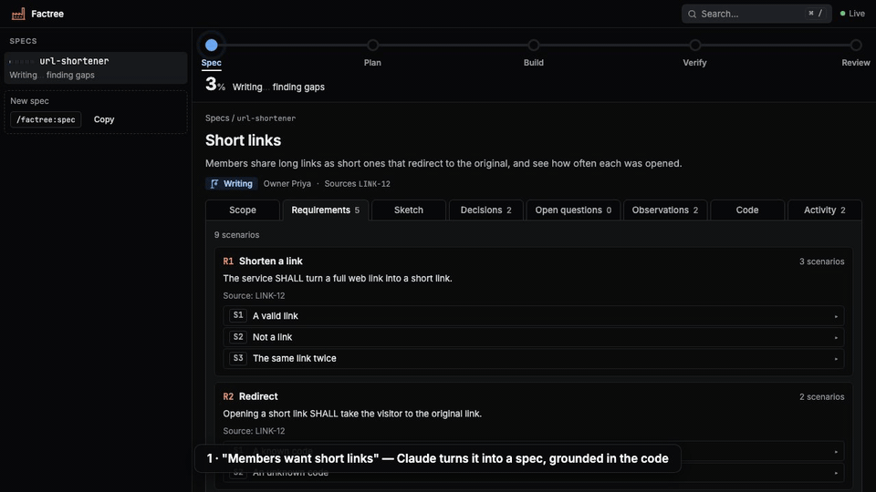

<div align="center">


# Factree

**A self-improving observable software factory for Claude Code.**

You decide. Factree specs, plans, builds, verifies and opens the pull request, stops only when it needs you, and learns from every decision.

[](plugins/factree/.claude-plugin/plugin.json)
[](#install)
[](LICENSE)
[](#status)

[Install](#install) · [Commands](#commands) · [The companion](#the-companion) · [Gets better as you use it](#gets-better-as-you-use-it) · [Configure](#configure) · [Roadmap](#status)

</div>

<p align="center"><br><sub>A URL shortener, from "members want short links" to a merged pull request, recorded from the real companion. You answer two decisions; Factree does the rest.</sub></p>

---

## Why Factree

- **Less prompting, more deciding.** Claude asks only what changes the build, as one numbered brief with a recommendation each. A single "yes" settles it. Everything else is Claude's call, listed so you can overrule it.
- **Every change starts as a spec.** A requirement from a ticket, a page or a chat becomes a spec grounded in your code: testable requirements, scenarios with IDs, what's in and out, and what must never happen.
- **Plans follow your repo, not a template.** Every pattern a plan reuses cites where your repo already does it. Anything new needs your approval by name.
- **Tasks fit one code review.** 300 changed lines by default, test-first, each proving named scenarios, reviewed by a fresh reviewer before it merges.
- **Evidence, not vibes.** Every scenario ends up **proved**, **failing** or **unverified**. A test that cites a scenario but doesn't check its outcome doesn't count. What nobody checked is never assumed.
- **It runs on its own once nothing is uncertain.** No approval clicks: answer the open decisions and it specs, plans, builds, verifies and opens the pull request in the same session. Review comments come back into the flow. It never merges.

## Install

```
/plugin marketplace add factree-dev/factree
/plugin install factree@factree
```

Restart Claude Code. **First run:** just run any command in a git repo, such as `/factree:spec <requirement>` or `/factree:ui`; Factree creates a workspace for it on your machine, never in the repo. Run `/factree:init` to put it somewhere else (a folder shared by several repos, or a central one) or to set starting preferences. To update: `/plugin` → factree → update, then start a new session.

## The 30-second tour

```
/factree:spec Members want short links that redirect, and to see how often each is opened
```

Claude reads the code, sizes the request, and sends one brief:

```
Decisions for you
1. Let members pick their own short codes? → Not yet: random 7-character codes (recommended). Otherwise: custom codes, first come first served.
2. Do short links expire? → Never, unless the owner deletes them (recommended). Otherwise: after a year without opens.
My calls: a. 302 redirects, so every open is counted  b. the same link twice → the same short link
Reply "yes" to take the recommendations, or e.g. "2: after a year".
```

Reply `yes` and Factree takes it from there, with no approvals to click through: a plan split by backend and frontend, tasks built in parallel git worktrees, each reviewed before it merges, a review of the whole branch, a verify, and a pull request:

```
url-shortener: 9 proved · 0 failing · 0 unverified
npm test: 214 passed · npm run build: ok
Pull request #42 opened: https://github.com/you/links/pull/42
```

Reviewer comments come back to Claude: a code change goes through build and verify again before it's pushed, a behaviour change through the spec first.

See the worked example from the recording: [the spec](examples/.factree/specs/url-shortener.md) and [the plan](examples/.factree/work/001-url-shortener/).

## Commands

| | Command | In | Out |
|---|---|---|---|
| **Spec** | `/factree:spec` | any requirement | `.factree/specs/<capability>.md`: purpose, scope and anti-goals, requirements with scenarios, a sketch of anything you'll see, decisions, open questions |
| **Plan** | `/factree:plan` | a spec with nothing open | `plan.md` (order, coverage, global constraints, review focus) plus a design and tasks for each vertical it touches: backend, frontend, infra… |
| **Build** | `/factree:build` | a plan with nothing open | commits on `factree/<work>`, one per task, test-first, reviewed, in parallel where the plan allows, then a review of the whole branch |
| **Verify** | `/factree:verify` | a spec | every scenario proved, failing or unverified, plus the typecheck and build |
| **Review** | `/factree:review` | a verified plan | a GitHub pull request saying what was built, proved and where to look; comments looped back through build or the spec; conflicts with the base resolved the repo's way and verified, or brought to you; never merged by Factree (needs the [GitHub CLI](https://cli.github.com)) |
| **Companion** | `/factree:ui` | a workspace | a local page following every spec live through the stages, where you can make the decisions Claude waits on |
| **Set up** | `/factree:init` | a repo or folder | a workspace where you want it, with starting preferences (optional: every command makes one on first use) |

## The companion

```
/factree:ui
```

A local page at `http://localhost:4747` that follows the factory live. Needs Node.js 20+; nothing to install.

- **Follow the loop.** Across the top of every spec, five stations (Spec, Plan, Build, Verify, Review) tick green as they finish. The active one ripples, blue while Claude works and orange while it waits on you, beside the percentage and what's happening: "Building… T2 of 3", "Verifying…", "2 decisions waiting". Click a station to open that stage. When the spec changes, the stages it undid turn grey until they're redone, and a change after review starts a new round.
- **One status everywhere.** The spec list, the line and the stage pages read the same state, so they never disagree. "Paused · 25 min ago" when a session has gone quiet.
- **Pull requests stay current.** Merges, closes and review decisions show up even when nothing is following the pull request: the session hook catches up in the background when a session starts, and at most every 5 minutes after.
- **Decide from the browser.** A spec waiting on you says so on every view; its **Decisions** tab holds a card per decision with the recommendation, the options and links to what it's about. `Enter` takes the recommendation, `1`–`9` picks an option, `r` requests changes. If the Claude Code session that asked is open, Claude carries on within seconds, with nothing typed.
- **See everything.** Specs (waiting on you first, then latest activity), requirements and scenarios, sketches, plans by vertical with their designs, diagrams and tasks, the build, the verify result (green once only checks a person must do are left, shown as "N need a person"), and the pull request with each reviewer's comment and how it was handled.
- **Find anything.** `⌘ /` searches every spec, requirement, scenario, decision, plan, task and pattern, and every item has a link you can share.

It writes nothing but your decisions. Specs and plans stay plain markdown in your local workspace.

## Gets better as you use it

- **It learns your repo.** Code no built-in lens covers (scripts, tooling, plugin files) gets a lens drafted from your conventions, approved once, saved in `.factree/lenses/` and reused by every later plan. Repo profiles cache how each project builds and tests.
- **It learns from what keeps happening.** After each verify, Factree looks for repeats and proposes up to three lessons:

| Loop | Learns from | Becomes |
|---|---|---|
| Your decisions | the same recommendation taken, or the same call overruled, again and again | a proposed preference or default |
| Reviews and failures | the same review finding or root cause across tasks | a rule in the repo's lens or profile |
| Escaped bugs | a bug found after a spec was verified | a new question in the spec and plan checklists |

- **It turns gaps into fixes.** A plan's Review focus sends untested failure modes back to the spec. Verify names what isn't proved and what would prove it. Every call Claude makes alone is logged with a one-click override.

Every lesson is proposed as a decision (in the terminal and as a card in the companion), never applied silently, and saved as a plain file in your workspace that later runs read: `preferences.md`, `defaults.md`, a lens, or `checklists/`. A lesson you reject is never proposed again.

## Configure

`.factree/preferences.md` in your workspace ([every key](plugins/factree/shared/preferences.md)):

```
flow: auto                   # stop only for open decisions; "step" stops for approval after every stage (default: auto)
review_budget: 300           # most changed lines per task (default: 300)
```

There are no approval stops: a spec or plan with nothing left open is approved by the flow and the work carries on. You're asked only for real decisions: an open question, a new pattern, dependency or lens, a stuck task, and the verify result.

<details>
<summary><b>Where things live</b></summary>

Everything goes in a `.factree/` workspace, found like git finds `.git`:

- `$FACTREE_HOME`, if set: a central place, possibly its own repo
- otherwise the nearest `.factree/` in the current folder or any parent, so one workspace can serve several repos beneath it
- otherwise `<repo root>/.factree`, created the first time a command needs it

Workspaces are local only: Factree keeps them out of git through the repo's own `.git/info/exclude`, never a tracked file, so nothing of Factree's lands in your team's repo.

```
.factree/
  specs/<capability>.md
  work/<NNN-slug>/plan.md, <vertical>/design.md, <vertical>/tasks.md
  profiles/<project>.md      # how each project is built
  lenses/                    # your own or generated lenses
  preferences.md             # your defaults
  defaults.md, checklists/   # lessons you approved
  events.jsonl               # activity log, each event tagged with its Claude Code session
  sessions/                  # what each session is doing (from the plugin's hooks)
```
</details>

<details>
<summary><b>Different kinds of code</b></summary>

The process is the same everywhere. What's specific to a kind of code lives in **lenses**: which patterns to look for, which scale questions matter, which gaps to check, which design sections to add, and which tests prove what. Factree detects the stack from your manifests and loads the right lenses.

Built in: **backend**, **frontend** and **infra** (Terraform, Helm, Docker and Compose, Kubernetes, CI). Code no lens covers gets a lens generated for it (see above). To adapt any lens to your team, add your version in `.factree/lenses/`.
</details>

## Status

| Stage | |
|---|---|
| Spec · Plan · Build · Verify · Review | ✅ working, running on their own end to end; merging stays with people |
| Companion | ✅ live view, decisions, search, the pull request and its comments |
| Self-improving loops | ✅ recording and proposing lessons; they get useful as runs accumulate |

## Develop

```
bash tests/run.sh                         # script tests: validators, detection, hooks, verify, review, workspace setup
cd apps/companion && npm install
npm test                                  # companion tests
npm run dev                               # companion on :5173 against the test fixture workspace
npm run build                             # rebuild into plugins/factree/ui (commit the result)
npm run demo                              # re-record docs/factree-demo.gif from the real companion (needs Chrome and ffmpeg)
```

Factree builds Factree: every change to this repo goes through its own spec, plan, build and verify, in a local `.factree/` workspace, which stays out of the repo like everyone else's. Skill test cases live in [`tests/*-skill/cases.md`](tests/).

## Credits

The spec, plan, build, verify and review skills borrow ideas from [obra/superpowers](https://github.com/obra/superpowers): sketches and playback from brainstorming, decisive steps and review focus from writing-plans, per-task and whole-branch review and the fix loop from subagent-driven development, evidence before claims from verification-before-completion, and checking review comments before acting on them from receiving-code-review.

## License

[MIT](LICENSE)
