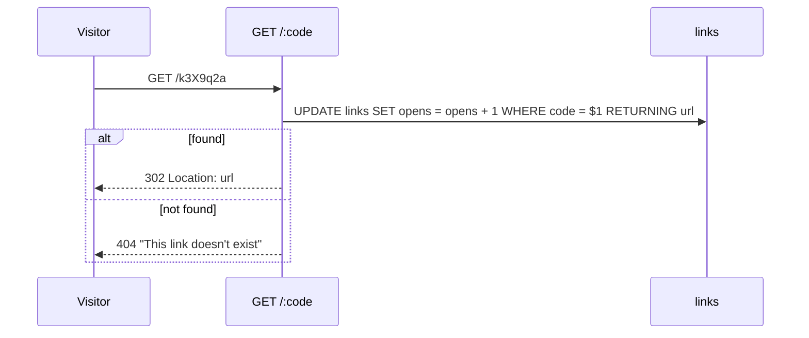

# Design: Short links (backend)

## Patterns

### Reused
- **P1 JSON routes with validation:** routes register in `api/src/routes/index.ts:9` and validate bodies with `validate(schema)` (`api/src/validate.ts:4`, used on `api/src/routes/members.ts:22`). Fits R1.S2: an invalid link is a 400 with the message.
- **P2 Migrations:** one SQL file per change in `api/migrations/`, as in `api/migrations/004_members.sql`. Fits the new links table.
- **P3 Route tests:** supertest against a test database, as in `api/test/members.test.ts`. Fits because R1–R4 are request-level behaviour.

### New
None.

## Approach
A `links` table keyed by a random code. `POST /links` validates the URL, returns the existing row for the same URL and owner (R1.S3) or inserts one with a code from `crypto.randomBytes`, retrying on the rare collision. `GET /:code` looks the code up, adds one to `opens` and redirects with 302 so every open reaches the server (R3).

**Alternatives considered**
- **Encode the row id in base62.** Rejected: sequential, so codes can be guessed (R4, D1).
- **301 redirects.** Rejected: browsers cache them, so repeat opens wouldn't be counted.

## Load and scale

| Assumption | Value | Source |
|---|---|---|
| Links | A few thousand a month | LINK-12 |

**What this means:** a unique index on `code` and on `(owner, url)` is all it needs.

## Components

| Component | Change | Responsibility | Serves |
|---|---|---|---|
| `api/migrations/007_links.sql` | New | `links` table | R1–R4 |
| `api/src/links/routes.ts` | New | `POST /links`, `GET /:code`, `GET /links` | R1, R2, R3 |
| `api/src/links/code.ts` | New | Random 7-character codes | R4 |

## Interfaces

### API contract

| Route | Returns |
|---|---|
| `POST /links` `{"url"}` | 201 `{"code","short","opens"}`, or 200 with the existing link; 400 `{"error":"Enter a full link starting with http:// or https://"}` |
| `GET /:code` | 302 to the link; 404 page "This link doesn't exist" |
| `GET /links` | 200 the owner's links with `opens` |

## Data
`links(code text primary key, url text, owner uuid, opens int default 0, created_at timestamptz)`, unique on `(owner, url)`.

## Flows
Open a short link (R2.S1, R3.S1):

## Error handling

| Scenario | Handling |
|---|---|
| R1.S2 Not a link | 400 with the message, nothing stored |
| R2.S2 An unknown code | 404 page |
| Code collision on insert | Retry with a new code, up to 3 times |

## Test strategy

| Scenario | Test type | File |
|---|---|---|
| R1.S1–S3, R2.S1–S2, R4.S1 | Route (supertest) | `api/test/links.test.ts` |
| R3.S1 | Route (supertest) | `api/test/link-opens.test.ts` |

## Risks and rollout
New routes only; rollback is reverting the commit and dropping the table.
