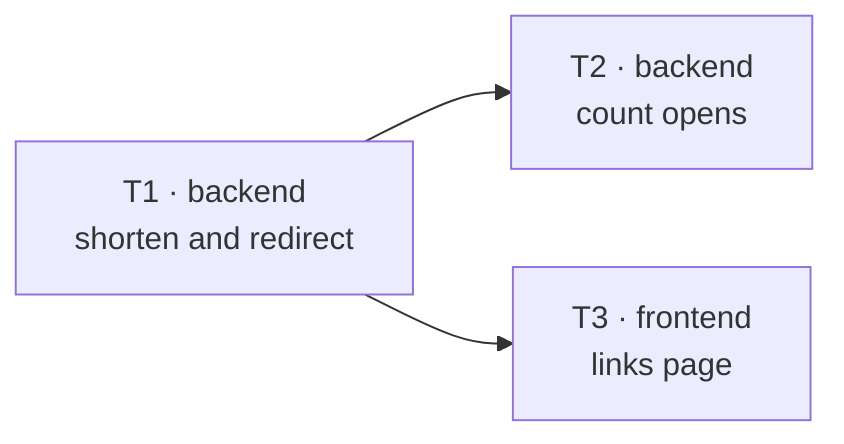

# Plan: Short links

## Context
Implements [url-shortener](../../specs/url-shortener.md) R1–R5. Nothing exists yet; the API's route and validation patterns (O1) and its migrations (O2) are reused. Codes are random and 7 characters (D1); links never expire (D2).

## Verticals
- **backend:** the links table, shortening, redirecting and counting opens ([design](backend/design.md), [tasks](backend/tasks.md); T1, T2)
- **frontend:** the links page with the shorten form and Copy ([design](frontend/design.md), [tasks](frontend/tasks.md); T3)

## Order
Tasks are numbered in build order across the plan. Each slice is the tasks, across verticals, that together deliver one behaviour.

1. **Shorten and follow a link (R1, R2, R4):** T1 (backend).
2. **Count opens (R3):** T2 (backend), after T1.
3. **Shorten from the page (R5):** T3 (frontend), after T1; it can run beside T2.

## Coverage

| Scenario | Task |
|---|---|
| url-shortener#R1.S1 A valid link | T1 (backend) |
| url-shortener#R1.S2 Not a link | T1 (backend) |
| url-shortener#R1.S3 The same link twice | T1 (backend) |
| url-shortener#R2.S1 A known code | T1 (backend) |
| url-shortener#R2.S2 An unknown code | T1 (backend) |
| url-shortener#R3.S1 Opened three times | T2 (backend) |
| url-shortener#R4.S1 Two in a row | T1 (backend) |
| url-shortener#R5.S1 Shorten and see it | T3 (frontend) |
| url-shortener#R5.S2 Copy | T3 (frontend) |

## Global constraints
- `POST /links` takes `{"url": string}` and returns `{"code": string, "short": string, "opens": number}`; `GET /:code` redirects with 302 (url-shortener R1, R2).

## Review focus
- Two members shortening the same link at the same moment: both must get one link back, not a duplicate-key error. Robustness: T1 adds `it("returns one link for two simultaneous requests")`.

## Spec updates
Updated the spec's **Code** section with the planned locations. No new decisions.
