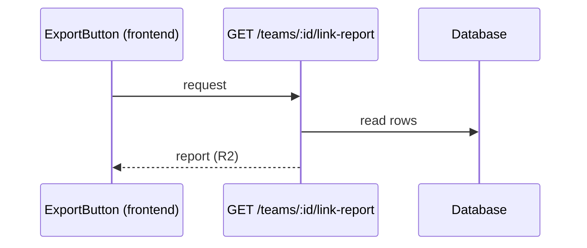

# Design: <spec title> (<vertical>)

<!-- Plan-wide parts (context, scope, status, coverage, spec updates) live in ../plan.md. An interface another vertical consumes is defined here; one this vertical consumes is linked, not restated. -->

## Patterns

### Reused
<!-- - **P1 <Area>:** <the pattern> (`path:line`, `path:line`). Fits because <why it suits this change>. -->

### New
<!-- - **N1 <Area>:** <what's new>. Needed because <why existing patterns don't fit>. Alternatives: <what else was considered>. Approved: <who>, <YYYY-MM-DD> -->
None.

## Approach
<The chosen approach in a few sentences.>

**Alternatives considered**
- **<Alternative>.** Rejected because <reason>.

## Load and scale

| Assumption | Value | Source |
|---|---|---|
| <what> | <number> | <spec R<n> / repo `path` / confirmed by <name>, <date>> |

**What this means:** <how these numbers shape the design.>

## Components

| Component | Change | Responsibility | Serves |
|---|---|---|---|
| `<path>` | New / Modify | <what it does> | R1 |

## Interfaces
<Exact signatures, API shapes or props, in the project's language.>

## Data
<Schema changes, migrations, backfills, client state shape — or "Not applicable.">

## Flows
<Each in-scope flow through three or more components, or across verticals, as a sequence diagram; "Not applicable." for a change inside one component.>

<!--

-->

## Error handling

| Scenario | Handling |
|---|---|
| R<n>.S<n> <name> | <what happens> |

## Test strategy

| Scenario | Test type | File |
|---|---|---|
| R<n>.S<n> | <from the lens test mapping> | `<path>` |

## Risks and rollout
<Feature flags, compatibility, migration order, rollback, and known risks.>

