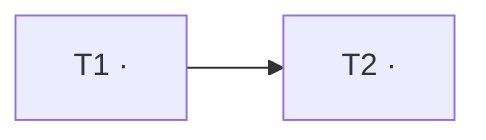

# Plan: <spec title>

## Context
<Which spec and requirements this implements, what exists today, and the spec decisions that constrain the design.>

## Verticals
- **<vertical>:** <what this vertical builds> ([design](<vertical>/design.md), [tasks](<vertical>/tasks.md); T1, T3)

## Order
Tasks are numbered in build order across the plan. Each slice is the tasks, across verticals, that together deliver one behaviour.

1. **<behaviour> (R1):** T1 (<vertical>), T2 (<vertical>)

## Coverage

| Scenario | Task |
|---|---|
| <spec>#R1.S1 <name> | T1 (<vertical>) |

## Global constraints
<Values every task must respect, copied word for word from the spec, one per line; or "None.">

## Review focus
- <an input or failure mode the spec implies but no scenario tests>: <proposed as R<n>.S<n> under Spec updates | test `<name>` added to T<n>>
<or "None found.">

## Spec updates
<Decisions added to the spec and Code section changes, or "None.">
