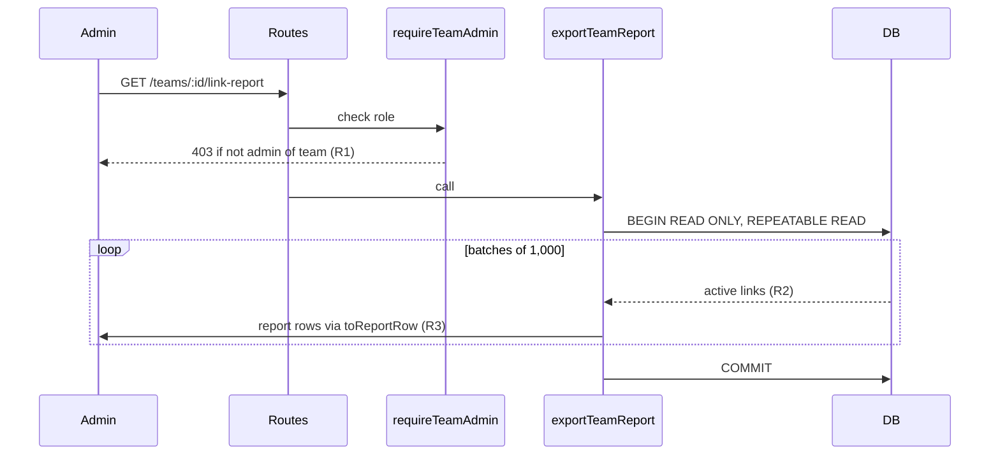

# Design: Link reports for teams

## Context
Implements all of [link-report](../../specs/link-report.md) (R1–R4); the spec is approved and nothing is built yet. Admins can already export a single link (`GET /links/:id/export`, `src/exports/routes.ts:18`). There is no team-level export.

Constraints from the spec's decisions: deleted links are excluded (D1), dates are ISO 8601 UTC (D2), rows are streamed rather than built in memory (D3).

## Patterns

### Reused
- **P1 Admin authorisation:** `requireTeamAdmin` middleware, as on the team settings routes (`src/teams/routes.ts:22`). Fits R1 exactly: it already returns 403 for non-admins and for admins of other teams (O3).
- **P2 Streaming report over HTTP:** the audit log export streams rows from a database cursor through `csv-stringify` into the response with `pipeline()` (`src/reports/audit-export.ts:40-78`). Fits R4 and D3: it serves exports of up to 250k rows in production today and starts sending within a second.
- **P3 Active links:** the `Link.active()` query scope (`src/models/link.ts:44`). Fits R2 and D1: it's the existing single definition of "not deleted", used by every list view.
- **P4 Feature flags:** new behaviour ships behind a flag registered in `src/flags.ts`, as with `audit_export_v2` (`src/flags.ts:31`). Fits because a new endpoint for all admins at once needs an instant rollback, and every recent feature here ships this way.
- **P5 Route tests:** supertest with factories, as in `test/exports/single-export.test.ts`. Performance checks live in `test/perf/` and run with `npm run test:perf`, as `test/perf/audit-export.perf.ts` does. Fits because R1–R3 are request-level behaviour and R4 is a latency target, which is exactly what these two setups cover.

### New
None.

## Approach
Add `GET /teams/:teamId/link-report`. The handler opens a read-only transaction, streams active links for the team from a cursor in batches of 1,000, maps each row to the five spec columns, and pipes them through `csv-stringify` to the response.

**Alternatives considered**
- **Background job with an emailed link.** Rejected: R4 needs the download to begin within 2 seconds, and at 100k rows streaming already meets that. A job queue would also be a new pattern in this repo.
- **Build the whole file in memory, then send.** Rejected by D3: about 60 MB per request at 100k rows, and nothing is sent until the end.

## Load and scale

| Assumption | Value | Source |
|---|---|---|
| Largest team | 100,000 active links | Spec R4 |
| Export volume | About 50 a day, peak 5 at once | Confirmed by John Doe, 2026-11-15 |
| `links` table | About 12M rows | Production stats in `docs/ops/table-sizes.md` |
| Index for the query | `links_team_id_deleted_at_idx` exists | Migration `20250412_add_team_deleted_idx` |

**What this means:** the query is an index range scan on `team_id` with `deleted_at IS NULL`, so no new index is needed. Five concurrent 100k-row streams fit within the existing pool of 20 connections. No queue and no caching.

## Components

| Component | Change | Responsibility | Serves |
|---|---|---|---|
| `src/exports/routes.ts` | Modify | Register the route behind P1 and the flag | R1 |
| `src/exports/team-report.ts` | New | Handler: open the transaction, stream rows, pipe the report | R2, R3, R4 |
| `src/exports/link-row.ts` | New | Map a link to the five spec columns | R3 |
| `src/flags.ts` | Modify | Register `team_link_report` | Rollout |

## Interfaces

```ts
// src/exports/link-row.ts
export const report_COLUMNS = ["owner_name", "owner_email", "link_name", "created_on", "expires_on"] as const;
export function toReportRow(c: LinkWithOwner): Record<typeof report_COLUMNS[number], string>;

// src/exports/team-report.ts
export async function exportTeamReport(req: Request<{ teamId: string }>, res: Response): Promise<void>;
```

`LinkWithOwner` is the existing joined type from `src/models/link.ts:12`.

## Data
No schema changes. Uses the existing index above.

## Flows



## Error handling

| Scenario | Handling |
|---|---|
| R1.S1, R1.S2 not an admin of the team | `requireTeamAdmin` returns 403 before the handler runs; no transaction opened |
| R2.S2 empty team | Cursor yields nothing; header row is still written, response 200 |
| R2.S3 deleted during export | Repeatable-read snapshot: the export reflects the team as it was when it started, so 3 rows, never a partial row |
| R3.S3 values with commas | `csv-stringify` quotes per RFC 4180 |
| Client disconnects midway | `pipeline()` rejects; handler destroys the cursor and rolls back |
| Database error before the first byte | 500 with the standard error body |
| Database error after streaming starts | Connection is destroyed so the client sees a truncated download, not a silently incomplete file |

## Test strategy

| Scenario | Test type | File |
|---|---|---|
| R1.S1, R1.S2 | Route (supertest) | `test/exports/team-report.test.ts` |
| R2.S1, R2.S2 | Route | `test/exports/team-report.test.ts` |
| R2.S3 | Route, revoking inside the stream via a test hook | `test/exports/team-report.test.ts` |
| R3.S1, R3.S2, R3.S3 | Unit | `test/exports/link-row.test.ts` |
| R4.S1 | Performance, seeded 100k rows | `test/perf/team-report.perf.ts` |

Every test names its scenario, e.g. `it("excludes deleted links [link-report#R2.S1]")`.

## Risks and rollout
- **Ships behind `team_link_report`**, off by default. Turn on for internal teams, then everyone. Rollback is turning the flag off.
- **Long transactions** hold a snapshot while streaming. At 100k rows the export takes about 8 seconds (audit export benchmark), which is acceptable. A 60-second statement timeout caps the worst case.
- **The performance test is slow** (seeding 100k rows), so it runs with `npm run test:perf`, not on every commit, matching the audit export.

## Spec updates
- Added **D4** to the spec: "Read each export inside a repeatable-read snapshot, because R2.S3 requires a consistent file even if links are deleted mid-export. (2026-11-15, John Doe)"
- Updated the spec's **Code** section with the planned locations.
