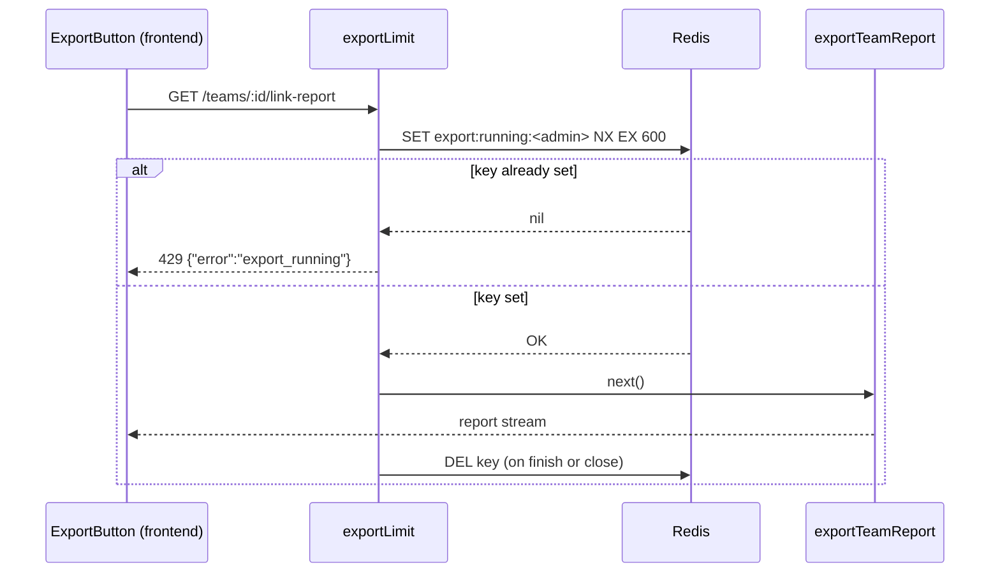

# Design: Link reports for teams (backend)

## Patterns

### Reused
- **P1 Per-user limits:** the `rateLimit` middleware keeps a per-user key in Redis with a TTL and returns 429 with the standard error body (`src/middleware/rate-limit.ts:12`, used on `src/auth/routes.ts:31`). Fits R6: a per-admin key, set when an export starts and cleared when it ends.
- **P2 Route tests:** supertest with factories, as in `test/exports/team-report.test.ts`. Fits because R6 is request-level behaviour.

### New
None.

## Approach
Add an `exportLimit` middleware before `exportTeamReport`. It sets `export:running:<adminId>` in Redis with `SET NX` and a 10-minute TTL, refuses with 429 if the key exists, and deletes the key when the response finishes or closes.

**Alternatives considered**
- **A lock held in process memory.** Rejected: the API runs on several instances, so a second request can land on another one.

## Load and scale

| Assumption | Value | Source |
|---|---|---|
| Exports | About 50 a day, peak 5 at once | work 001 design, confirmed by John Doe, 2026-11-15 |

**What this means:** one Redis key per running export; negligible.

## Components

| Component | Change | Responsibility | Serves |
|---|---|---|---|
| `src/exports/limit.ts` | New | `exportLimit` middleware | R6 |
| `src/exports/routes.ts` | Modify | Add `exportLimit` to the team export route | R6 |

## Interfaces

### API contract
`GET /teams/:teamId/link-report` (from work 001) gains one response:

| Status | When | Body |
|---|---|---|
| 429 | The same admin already has an export running | `{"error":"export_running"}` |

The frontend's T2 relies on exactly this status and body.

## Data
No schema changes. One Redis key per running export, `export:running:<adminId>`, with a 10-minute TTL as a safety net.

## Flows
A second export while the first runs (R6.S1), from the frontend's button (R5.S2):

## Error handling

| Scenario | Handling |
|---|---|
| R6.S1 Second export while the first runs | 429 `{"error":"export_running"}`, before any database work |
| Redis unavailable | Let the export run (fail open) and log a warning: the limit protects the database, it doesn't guard data |
| Process dies mid-export | Key expires after 10 minutes |

## Test strategy

| Scenario | Test type | File |
|---|---|---|
| R6.S1, R6.S2 | Route (supertest), Redis from the test container | `test/exports/export-limit.test.ts` |

## Risks and rollout
Ships behind the existing `team_link_report` flag. Rollback is removing the middleware from the route.
