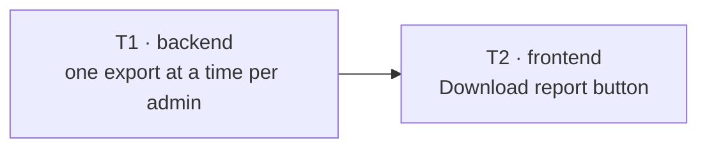

# Plan: Link reports for teams (button and export limit)

## Context
Implements [link-report](../../specs/link-report.md) R5 and R6. The export endpoint from work 001 (R1–R4) exists. There is no button for it yet, and nothing stops an admin starting several exports at once. Constraint from the spec: exports stream (D3), so a running export holds a database snapshot for its whole duration (D4). That's why the limit matters.

## Verticals
- **backend:** the one-export-at-a-time limit on the export endpoint ([design](backend/design.md), [tasks](backend/tasks.md); T1)
- **frontend:** the Download report button on the team page, including the "already running" message ([design](frontend/design.md), [tasks](frontend/tasks.md); T2)

## Order
Tasks are numbered in build order across the plan. Each slice is the tasks, across verticals, that together deliver one behaviour.

1. **One export at a time, end to end (R6, R5):** T1 (backend) adds the 429 response, then T2 (frontend) adds the button and shows the message when it gets a 429.

## Coverage

| Scenario | Task |
|---|---|
| link-report#R5.S1 Admin downloads | T2 (frontend) |
| link-report#R5.S2 Export already running | T2 (frontend) |
| link-report#R6.S1 Second export while the first runs | T1 (backend) |
| link-report#R6.S2 Export after the first finishes | T1 (backend) |

## Global constraints
- One export per admin at a time; a second request while one runs is refused with 429 `{"error":"export_running"}` (link-report R6).

## Review focus
- An admin who closes the tab mid-export: the running export must still end, so the next one isn't refused forever. Robustness: T1 adds `it("frees the limit when the client disconnects")`.
- A double click on the button: the second click must not start a second request. Behaviour: proposed to the spec as R5.S3 under Spec updates.

## Spec updates
Updated the spec's **Code** section with the planned locations. No new decisions. Proposed: R5.S3 Double click, from Review focus.
